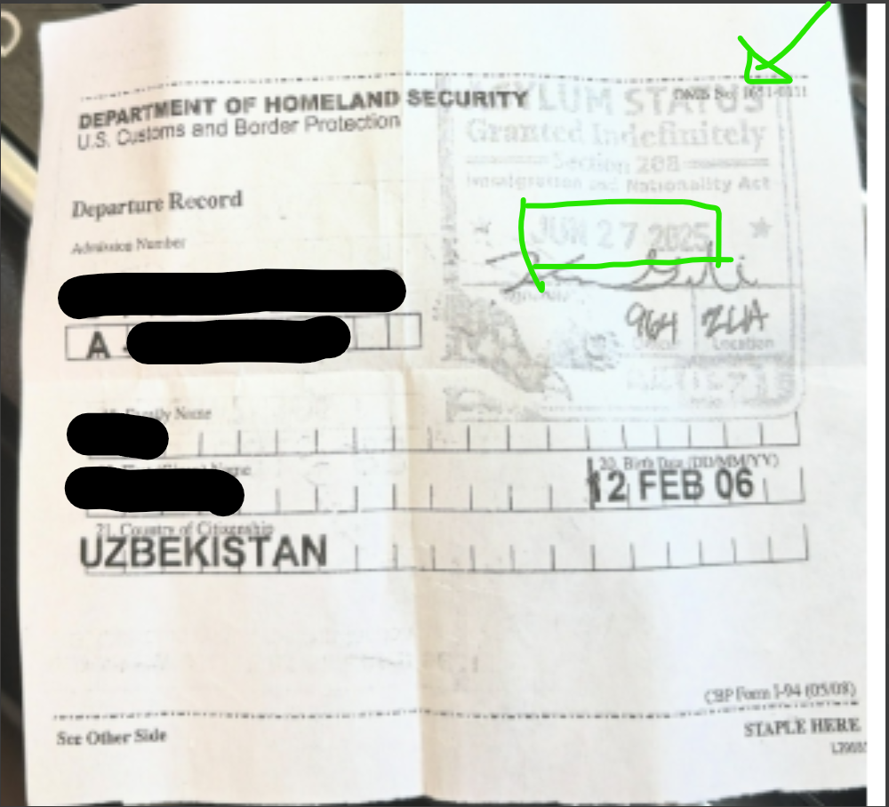

# Residency Special Statuses & Exceptions

[← California Residency processing guide](residency.md)

## AB 540

### Student Forgot to Turn In Form

- Have them fill out the [AB 540 form](https://sac.edu/sacab540) and backdate to the beginning of that term.
- AB 540 only needs to be submitted once. If previously AB 540, broke enrollment, and submitted new application as Non-Resident, we can backdate their AB 540 status to the beginning of the new term.
- According to the California Community Colleges Chancellor’s Office (California Community Colleges Chancellor’s Office [CCCCO], n.d.), if a student provides late documentation for the AB 540 tuition exemption, "the exemption should be applied retroactively."

### Switching to CA Resident

- If US Citizen: only need naturalization paperwork (for continuing students) and a new application.

### Homeschooled

- Put "homeschooled" in high school information area and ask for high school diploma.

### Lists CEC

- AB 540 is an affidavit — if they attest it is true, process it. Only ask for verification if there is conflicting information between ASUM and the form (per Pilar).

### Student Not Living in CA

!!! danger
    Students must be **living in CA** to qualify. Long-distance learners residing out of state **do not qualify** per Chancellor's Office (CCCCO Residency Overview, 2025).

## Active Military

- If stationed in CA: use orders to change status to `E` or `EB`. No minimum duration required (per Residency Overview).
    - If home of record is also CA: can make them a CA Resident.
- If stationed outside CA: provide documentation (MOL or military record) that home of record is CA → update to `R`.
    - If home of record is a state we can't serve, they cannot take courses with us.
- **Dependents:**
    - Spouse/child of active-duty member stationed in CA qualifies for resident classification with no limit on duration.
    - Only need DEERS card (no copy) and stationed-in-CA orders.

| Document Type | What to Verify | Intent | Physical Presence |
|---------------|----------------|--------|-------------------|
| DD Form 2058 (State of Legal Residence Certificate) | California listed as legal residence | ✅ | ❌ |
| Leave and Earnings Statement (LES) | California listed as State of Legal Residence (SLR) | ✅ | ❌ |
| California Driver License or California Identification Card | Issue date and validity | ✅ | ❌ |
| California Voter Registration | Registration date and voting activity | ✅ | ❌ |
| California Vehicle Registration | California registration and issue date | ✅ | ❌ |
| California Professional License | Issue date and active status | ✅ | ❌ |
| California Resident Income Tax Return (Form 540) | California resident filing status | ✅ | ✅ |
| California Property Tax Bill | California property ownership and tax year | ✅ | ✅ |
| California Mortgage Statement | California property address and statement date | ✅ | ✅ |
| Military Orders | Active-duty status and duty assignment | ❌ | ❌* |
| Utility Bill for California Residence | California service address and statement date | ❌ | ✅ |
| Lease or Rental Agreement for California Residence | California address and lease dates | ❌ | ✅ |

\* Military orders generally establish military status and out-of-state assignment but do not independently establish California intent or physical presence.

## Asylum Documentation

Sample of I-94 with Asylum status classification

## Automatic CA Residency (by Ed Code)

| Category | Ed Code |
|----------|---------|
| Nonresident minor whose parent left California | ECS 68070 |
| Self-Supporting Student | ECS 68071 |
| Under 2-year care/control of a CA-resident adult | ECS 68073 |
| Adult dependent child of CA resident | ECS 68076 |
| Graduate of Bureau of Indian Affairs school | ECS 68077 |
| Employees of public schools | ECS 68078 |
| State government fellowship student (state/CSU) | ECS 68081 |
| Native American at Bureau of Indian Affairs school in district | ECS 68082 |
| Team USA student athlete training in state | ECS 68083 |

## Visa and Immigration Status

### B Students

!!! danger
    B visa students are **not allowed** to take classes with us.

### C Students (Asylum)

- C08 = asylum applicants.
- Before 1 year since CA arrival: **exempt** from non-resident tuition.
- After 1 year: must show receipt received dates ≥ 1 year + 1 day before semester start, plus 2 proofs of CA Residency.

### DACA

- EAD must be **Category C33**.
- Must meet the one year + one day requirement or have a Notice of Action receipt that meets it.
- No residency questionnaire required — just proofs.

### Employment Authorization

- Check [USCIS EAD Codes](https://www.uscis.gov/archive/automatic-employment-authorization-document-ead-extension) for code reference.
- Check [CA Residency Overview 2025 (CCCCO)](https://www.cccco.edu/-/media/CCCCO-Website/docs/general/2025residencyoverviewdocument42125finala11y.pdf?la=en&hash=8A1227B6F9DB6D13138B0AF0E3E5EA4EF198232D) page 11 for accepted statuses.
- If the student has an eligible status, ask for their I-797 Notice of Action of proof of the application of that status.

### F1 Students Changing to CA Residency

Required: Application for PR or USC status + PR card or Passport + intent to stay in CA + 2 proofs of 1 year + 1 day CA residency.

1. Fill out a new application (no reclass form needed).
2. Send to **International Students** to sign off.
3. Update ASUM, BIO, ASPR.
4. Call Cashier's for rebill if needed.

!!! info "Blended Staff/Student"
    Send to Job Placement to update demographics from F-1 to Permanent Resident first, then return to process reclass.

!!! danger
    **F1 and B1 students do NOT qualify for AB 540.**

Note: PR/USC application starts the clock from application date. F1 status does not need to be expired. Does not have to be approved *(CACCRAO 4/29/25)*. Changing F1 → H1: H1 must be approved *(Residency Overview p.11)*.

### H1 Students

- Need H1 visa info showing ≥ 1 year + 1 day issue date and 2 proofs of CA residency.

### H4 Students

- Need spouse's/parent's H1 visa + H4 visa + student's 2 proofs of CA residency.

### K1 Visa

- As long as issue date is ≥ 1 year + 1 day, can be used as citizenship status.

### Permanent Residents

- Can use US birth certificate, naturalization papers, or passport for citizenship.
- **I-797 (Notice of Action)** received date can be used to backdate presence.
- Application for extension or renewal can be used — **does not have to be approved**.
- If applying for US Citizenship: ask for **N-400** if PR Card is expired (shows 24-month extension).

### R1/R2 Visas

- OK to establish CA Residency (per Pilar).

### Refugees

- Immediate exemption from non-resident tuition within first year *(Ed Code 68075.6, effective Jan 1, 2018)*.
- After first year: must provide 2 proofs of CA residency.

## Additional Status-Based Situations

### CER (Continuing Education Residents)

1. Check **ASUM** for the semester applied — if Resident, update on **ASPR**. No comments needed.
2. Update home location.
3. If Financial Aid sends an AIDE error: check dates on ASPR — insert a new R/N line more recent than the CER status if needed.

### Criminal Justice Academies Students

Per Ed Code §76140: a community college may classify a nonresident student **hired by a public agency** as a resident while enrolled in a **police academy training course**.

### Financial Aid

- CA Residents qualify for more aid than AB 540 students. AB 540 US citizens still receive Pell Grants and fee waivers.
- If Financial Aid asks to update the Student Type date: **do not update**. They likely mean the residency status date — check ASPR.

### Foster Youth

- Will be flagged as non-residents. If everything else checks out, change to CA Resident and note: student is foster youth / guardian is other than parent.
- Refer to **Guardian Scholars**: (714) 564-6302.

### Veterans

- DD-214 shows separation within last 3 years → mark as Exempt (`E` in ASPR).
- Valid CA Driver License + home of record is CA on DD-214 → mark as Resident (per Pilar).
- Stationed in CA > 1 year immediately before discharge → exempt from non-resident tuition for up to 1 year if affidavit of intent to establish CA residency is filed. Must be used within 2 years of discharge.
- If VRC sends signed **VACA form** → update ASPR to VACA (per Pilar).

## Related Guidance

- [Proof Requirements & Eligibility](residency-proof.md)
- [Student Scenarios & Additional Notes](residency-student-scenarios.md)
