# Transcript Evaluation — Transfer Units

## Overview
This section provides guidelines and procedures for evaluating transfer units from other institutions. It covers the steps for researching and verifying the accreditation of the sending institution, assessing the transferability of courses, and documenting the evaluated units before entry into the student's academic record.

## Student Verification

Even though the intake team initially reviews and matches students with their records, it is important to still re-verify that we have the correct student tied to the academic record before proceeding with the evaluation.

## Institution Verification

Before evaluating transfer units, we want to make sure that we are using the institution with the CEEB code attached to it.

1. Navigate to IASU on Colleague for the desired student.
2. Detail into the desired school.

    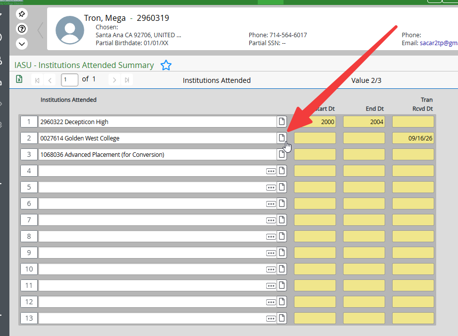

3. Ensure that the institution has a CEEB code associated with it.

    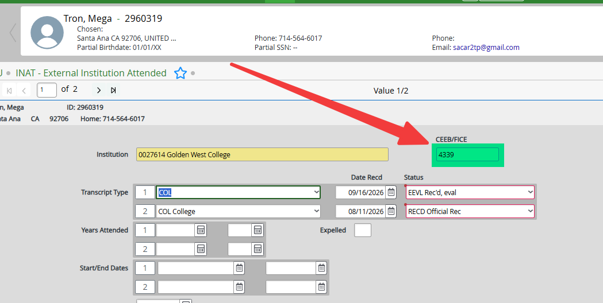

4. If the institution does not have a CEEB code, check the [Master CEEB Code list](https://rsccd.sharepoint.com/:x:/s/Admissions2/IQAge6IURGvqR5TNkX6Uo-wgAZ9wIGMJVYeQT0kYCS-0Rn8?e=5Aaph0) to find the appropriate school ID and create a new line on IASU with the correct details.


## Accreditation

Ensure that the institution is recognized by a legitimate a regional accrediting body before proceeding with the evaluation.

| Accreditation | Accrediting Agency |
|--------------|-------------------|
| MSCHE | Middle States Commission on Higher Education |
| NCA-HLC | Higher Learning Commission (formerly North Central Association of Schools and Colleges) |
| NWCCU | Northwest Commission on Colleges and Universities |
| NEASC-CIHE | New England Association of Schools and Colleges, Commission on Institutions of Higher Education (New England Commission of Higher Education) |
| SACS | Southern Association of Colleges and Schools, Commission on Colleges |
| WASC-ACCJC | Western Association of Schools and Colleges, Accrediting Commission for Community and Junior Colleges |
| WASC-ACACS | Western Association of Schools and Colleges, Accrediting Commission for Senior Colleges and Universities |

### Checking Accreditation

Accreditation information can be found through the [Transfer Evaluation System](https://tes.collegesource.com/TES_login.aspx).

1. Log into TES.

2. Click Search.

    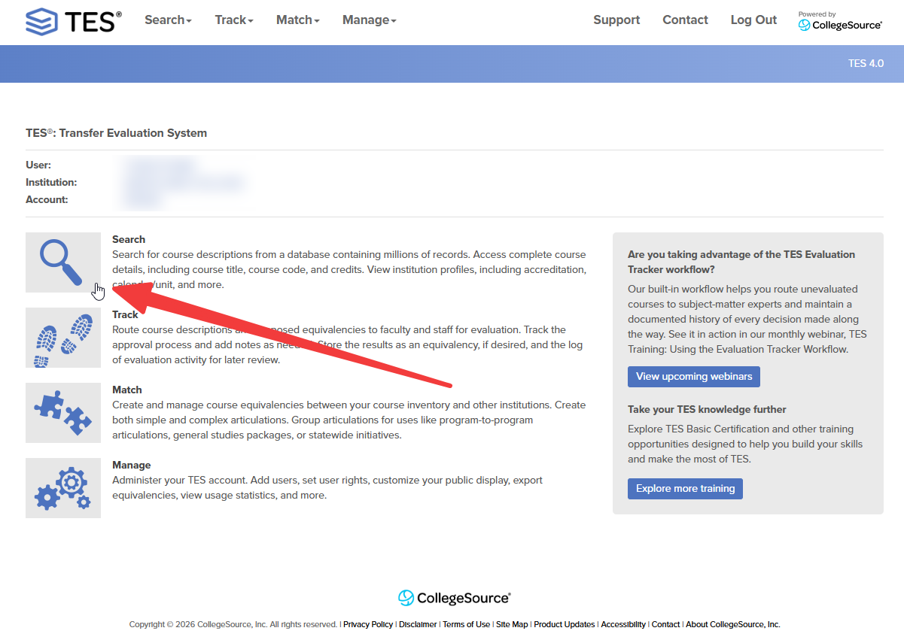

3. Enter the institution name in the search field and click **Search**.

    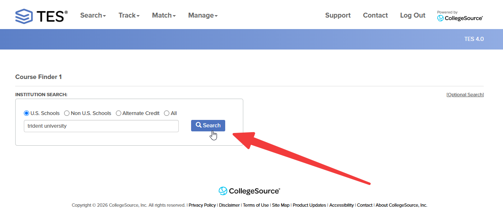

4. Click on the blue button next to the desired institution to view its details.

    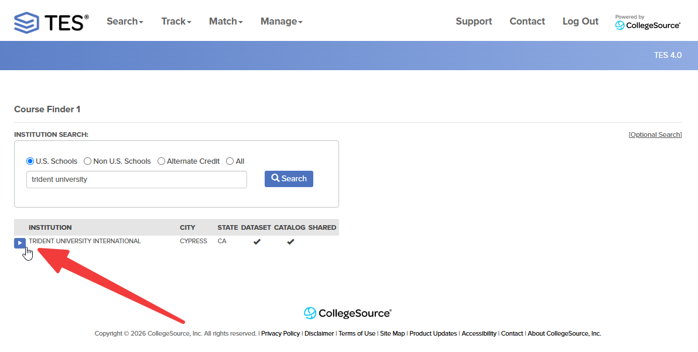

5. Click on the "View institution profile" icon.

    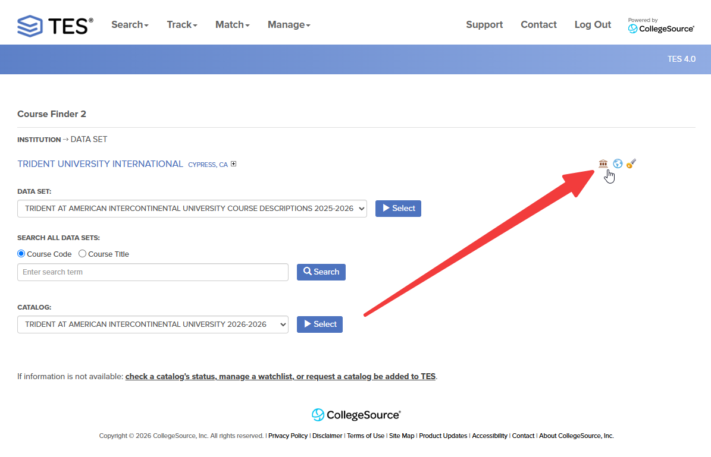

6. Review the accreditation information listed on the institution profile to ensure it is recognized by a legitimate regional accrediting body.

    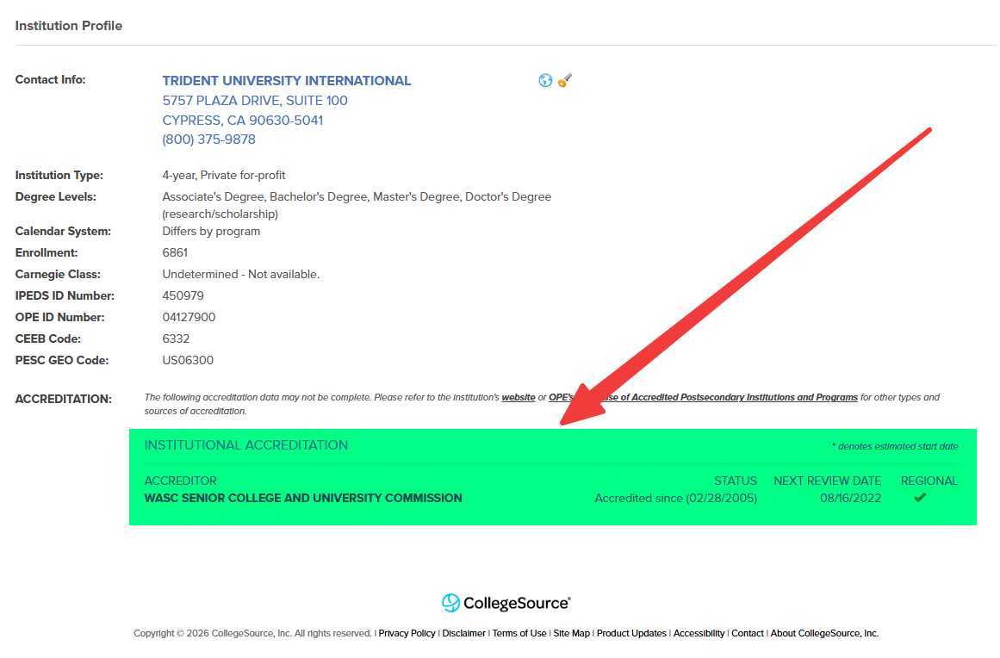

7. If the institution is not recognized by a legitimate regional accrediting body, **DO NOT** proceed with the evaluation.

!!! note "Alternative Accreditation Checking Option"
    If the accreditation information is not available through TES, you can alternatively check the institution's official website or visit the Database of Accredited Postsecondary Institutions and Programs (DAPIP) [here](https://ope.ed.gov/dapip/#/home) to verify its accreditation status.

## Calendar System

The calendar system of the institution should be verified to accurately evaluate transfer units.

### Checking the Calendar System

1. Follow the same steps as [verifying accreditation](#checking-accreditation) to access the institution profile in TES.

2. Look for the calendar system information on the institution profile.

    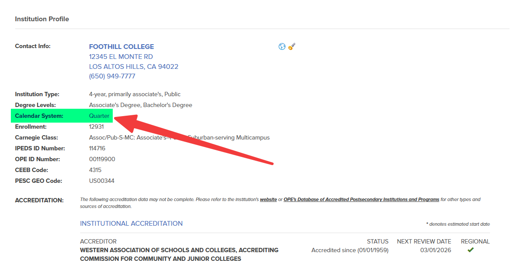

3. If the calendar system is not listed or unclear, you can check the institution's transcript key as well.

    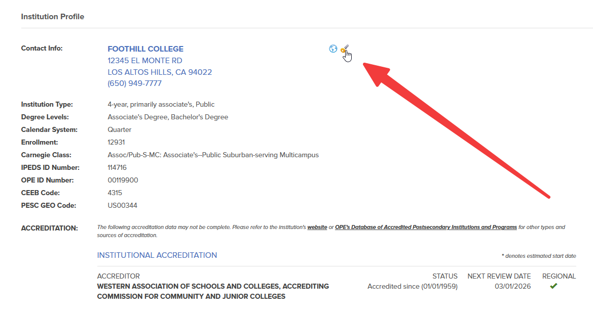

4. Take note of the calendar system used by the institution to ensure accurate evaluation of transfer units (e.g., semester, quarter, trimester).

    !!! note "Alternative Transcript Key Checking Option"
        If the transcript key information is not available on the Course Finder 2 page, you can alternatively check the institution's official website or review the corresponding catalog on TES to verify the transcript key used by the institution.

## Course Numbering System

The course numbering system of the institution should be verified to accurately evaluate transfer units.

### Checking the Course Numbering System

1. Follow the same steps as [verifying accreditation](#checking-accreditation) to access the institution profile in TES.

2. Click on the institution's transcript key.

    

3. Take note of the course numbering system used by the institution to ensure accurate evaluation of transfer units (e.g., 100-level, 200-level, 300-level).

    !!! note "Alternative Transcript Key Checking Option"
        If the transcript key information is not available on the Course Finder 2 page, you can alternatively check the institution's official website or review the corresponding catalog on TES to verify the transcript key used by the institution.

    !!! warning "Important"
        Each school may have a different course numbering system, so it is important to verify it for each institution individually.

        - E.g., Long Beach City College courses from 1-99 are considered transferable and anything higher is not.
        - E.g., Orange Coast College courses from 100 and up are considered transferable and anything lower is not.

## Determining Which Courses To Ignore

### Non-Degree Applicable Courses

The degree applicability of courses from the institution should be verified to accurately evaluate transfer units.

#### Checking Degree Applicability

1. From the Course Finder 2 page, click on applicable academic year of the catalog you want to review.

    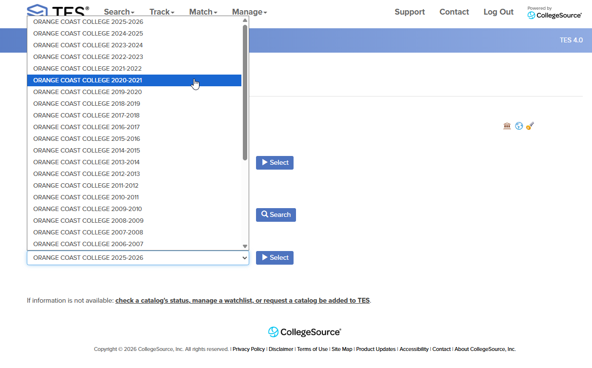

2. Click Select to view the catalog.

    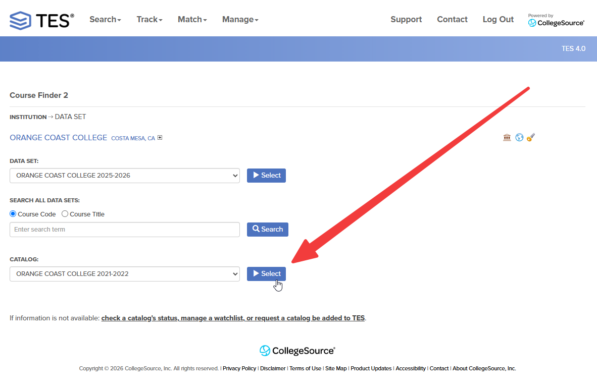

3. Navigate through the catalog to the course descriptions.

    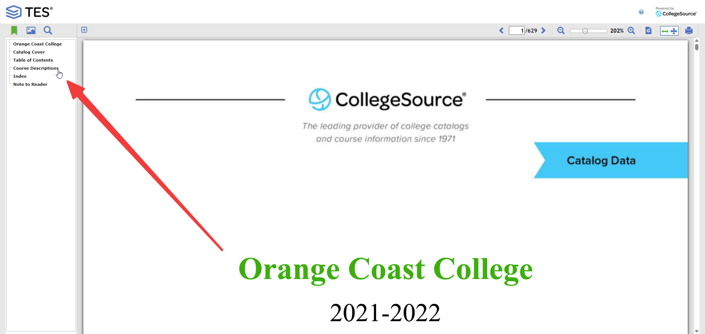

4. Compare between course descriptions to see what counts as degree applicable or not. This will require your judgment call based on the information provided in the catalog.

    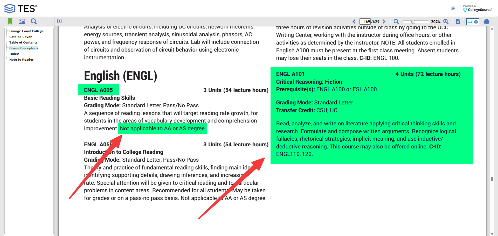

    !!! tip "Tip"
        Search for classic non-degree applicable courses like pre-algebra, English as a Second Language (ESL), etc. to quickly identify courses that may not count towards degree requirements and then compare with the courses you are checking from the student's transcript.

4. Line out any courses on the student's transcript that are identified as non-degree applicable based on the catalog review.

5. **DO NOT** count any units for non-degree applicable courses towards the student's transfer credit.

    !!! warning "Intermediate Algebra"
        Intermediate Algebra courses are typically considered non-degree applicable for 4-year institutions but we still count them towards transfer credit.

### In Progress Courses

The evaluation of in progress courses from the institution should be verified to accurately assess transfer units.

#### Checking for In Progress Courses

1. Click on the institution's transcript key.

    

2. Review the transcript key to identify how each school indicates in progress courses.

    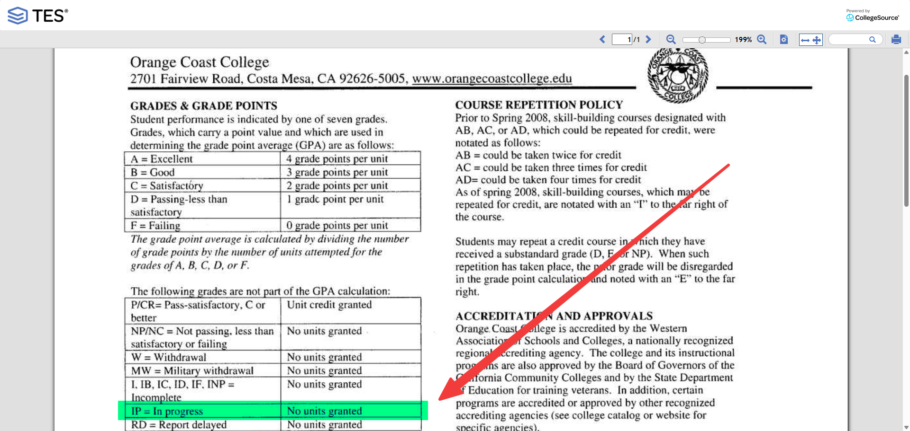

3. Line out any in progress courses on the student's transcript that are not eligible for credit based on the catalog review.

4. **DO NOT** count any units for in progress courses towards the student's transfer credit until the courses are completed and grades are posted.

### Repeated Courses

The evaluation of repeated courses from the institution should be verified to accurately assess transfer units.

#### Checking for Repeated Courses

1. Click on the institution's transcript key.

    

2. Review the transcript key to identify how each school indicates repeated courses.

    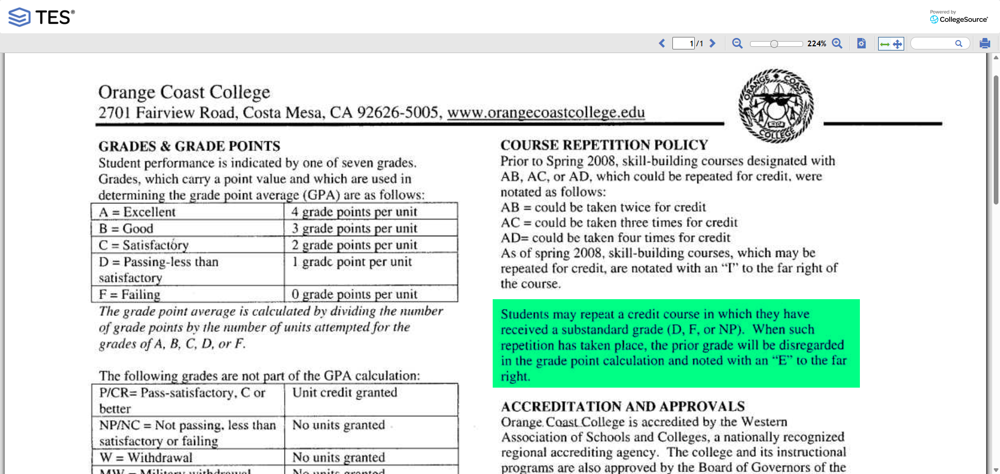

3. Line out any repeated courses on the student's transcript that are not eligible for credit based on the catalog review.

4. Only count these units in the UNITS ATMPT column on the transcript.

    !!! note "Alternative Transcript Key Checking Option"
        If the transcript key information is not available on the Course Finder 2 page, you can alternatively check the institution's official website or review the corresponding catalog on TES to verify the transcript key used by the institution.

## Evaluating External Courses That Match Local Courses

Compare the external coursework against the student's local RSCCD coursework. This review prevents duplicate degree credit while ensuring that all attempted coursework is captured for Financial Aid Satisfactory Academic Progress (SAP).

!!! important "Core Rule"
    **Always capture all attempted units, but never award completed units more than once for equivalent coursework.**

## Transfer Totals Columns

Use the following order when entering Transfer Totals:

| Column | Enter |
|----------|----------|
| First Column | Attempted Units |
| Second Column | Completed Units |
| Third Column | GPA Units |
| Fourth Column | Grade Points |

!!! warning "Transfer Totals and EXTS Are Separate Decisions"
    Entering a course in Transfer Totals is not the same as entering the external course in EXTS. Follow the applicable scenario below to determine both actions.

## Determine the Applicable Scenario

### Scenario 1: Local Fail + External Pass

Use this scenario when:

- The student earned a local **F**, **D**, or **NP**; and
- The student later completed an equivalent external course with an **A**, **B**, **C**, or **P**.

#### Transfer Totals Entry

Calculate the external course exactly as reported on the external transcript:

- Full Attempted Units (first column)
- Full Completed Units (second column)
- Full GPA Units (third column)
- Full Grade Points (fourth column)

#### EXTS Action

- Enter the external course in **EXTS**.
- Use the external course to support repeat/alleviation processing.
- Complete the STAC updates described below.

#### Result

- Degree credit is awarded from the external passing course.
- The local GPA impact is removed.
- The student's record reflects successful course completion.
- Both attempts remain represented for Financial Aid SAP purposes.

---

### Scenario 2: Local Pass + External Pass (Duplicate Credit)

Use this scenario when the student already earned passing credit locally and later completed an equivalent course externally.

#### Transfer Totals Entry

Enter:

- Full Attempted Units (first column)
- **0.00 Completed Units** (second column)
- **0.00 GPA Units** (third column)
- **0.00 Grade Points** (fourth column)

#### EXTS Action

- **Do not** enter the external course in **EXTS**.
- Leave the local passing course unchanged.

#### Result

- The external attempt is captured.
- Degree credit is not awarded twice.
- Financial Aid can still see the additional attempt.

!!! warning "Do Not Award Duplicate Credit"
    Completed units should not be awarded for an external course when the student has already received passing credit for the equivalent RSCCD course.

---

### Scenario 3: All Other Scenarios (Standard Transfer Processing)

This includes:

- Local Pass + External Fail
- Local Fail + External Fail
- External Pass (No Local Match)
- External Fail (No Local Match)
- Any situation that does not create duplicate passing credit

#### Transfer Totals Entry

Enter all units exactly as reported on the external transcript:

- Attempted Units
- Completed Units
- GPA Units
- Grade Points

A failed course will typically have attempted units but **0.00 completed units**.

#### EXTS Action

- Enter the external course in **EXTS**.

#### Result

- The transfer record accurately reflects the external institution.
- Financial Aid SAP calculations remain compliant.
- No duplicate passing credit is created.

---

## At-a-Glance Cheat Sheet

| Scenario | Transfer Totals Entry | EXTS Action | Result |
|-----------|-----------|-----------|-----------|
| **Local Fail + External Pass** | Full Attempted + Full Completed + Full GPA Units + Full Grade Points | Enter in EXTS | GPA alleviated, degree credit awarded, both attempts retained |
| **Local Pass + External Pass** | Full Attempted Units + 0.00 Completed Units + 0.00 GPA Units + 0.00 Grade Points | Do Not Enter | Prevents duplicate degree credit while retaining attempt |
| **All Other Scenarios** | Enter all values exactly as reported | Enter in EXTS | Standard transfer processing |

## Local Fail + External Pass: Automatic Renewal Steps

After transferring the external course and entering it in **EXTS**, update the equivalent local failed course.

1. Open **STAC** and locate the student.
2. Detail into the applicable local failed course.
3. Update **Credit Type** to:

    ```
    AR
    ```

4. Update **Replace Allowed** to:

    ```
    N
    ```

5. Detail into **Notes/Comments**.
6. In **Notes/Dates**, enter:

    ```
    TRR
    ```

7. In **Printed Comments**, enter:

    ```
    Repeated at [External College Name]
    ```

    Example:

    ```
    Repeated at Orange Coast College
    ```

8. Save and exit.

### Result

- The local failed course is properly coded for repeat/alleviation processing.
- The local GPA impact is removed through the external passing completion.
- Degree credit is awarded based on the external passing course.
- Financial Aid SAP continues to reflect both attempted enrollments.

## STAC Quick Reference

| Field | Value |
|---------|---------|
| Credit Type | AR |
| Replace Allowed | N |
| Notes/Dates | TRR |
| Printed Comments | Repeated at [External College Name] |

## Final Verification Checklist

Before completing the evaluation, confirm:

- External course was entered correctly in Transfer Totals.
- Appropriate EXTS action was taken.
- Duplicate passing credit was not awarded.
- Attempted units were captured.
- Completed units were not counted twice.
- STAC updates were completed when applicable.
- Financial Aid SAP requirements remain satisfied.

!!! note "Key Principle"
    Always capture all attempted units, but never award completed units more than once for equivalent coursework.

## Calculating Transfer Units

1. Sum all the units for courses that are eligible for transfer credit.
    - You can find a cheat sheet [here](https://rsccd.sharepoint.com/:x:/s/Admissions2/IQAJYeNdOTO3TpPQ44pOwSBGAb04PCdcgoNhhND5AlGWmdE?e=hGWJLa).
    - Exclude any units for non-degree applicable courses and in progress courses.
    - Include units for repeated courses only in the UNITS ATMPT column as per the institution's transcript key.
    - Verify the total transfer units against the student's transcript and the catalog review to ensure accuracy.
2. Once units are calculated, proceed to [Transfer Unit Entry](../../ariii/transcripts/transcript-entry-transfer-units.md).