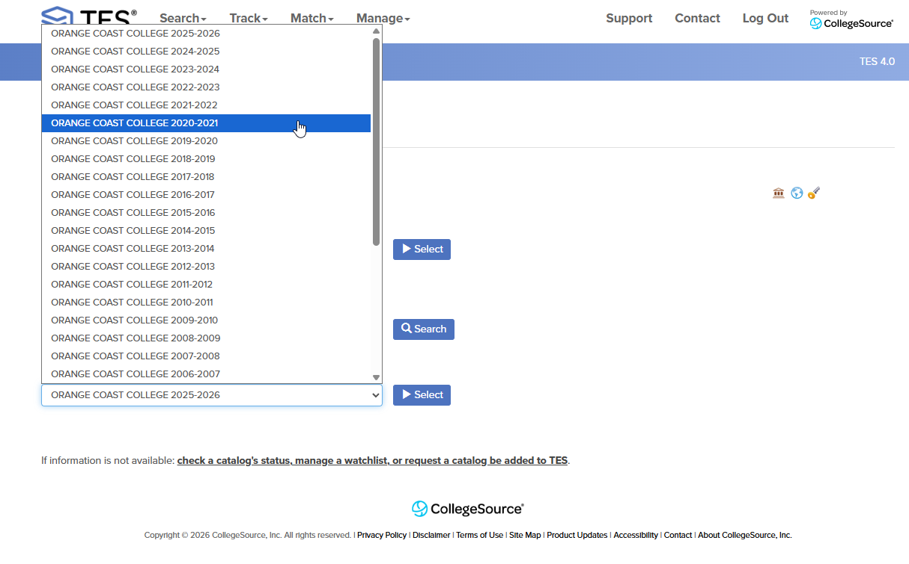
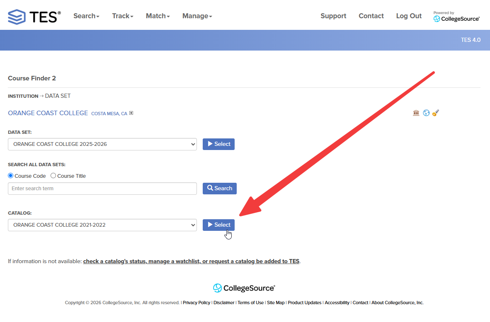
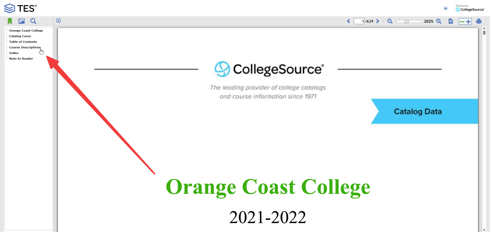
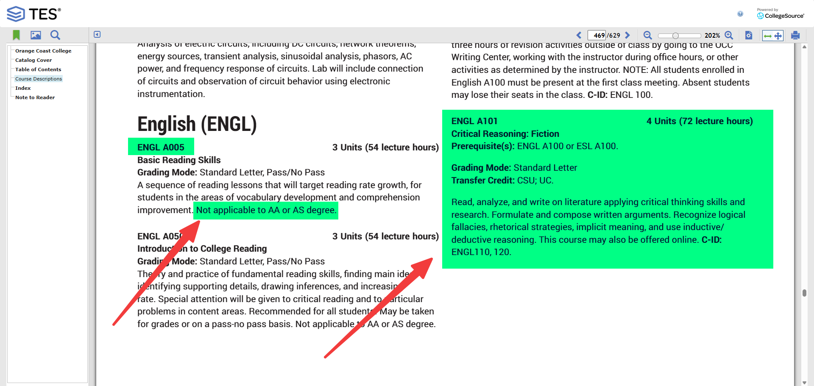
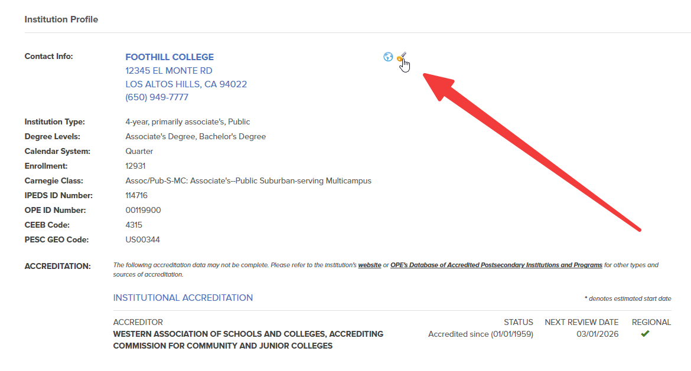
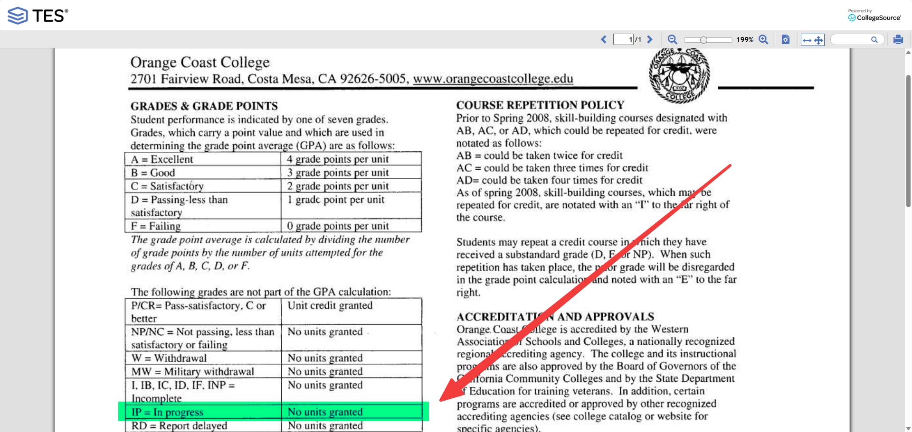
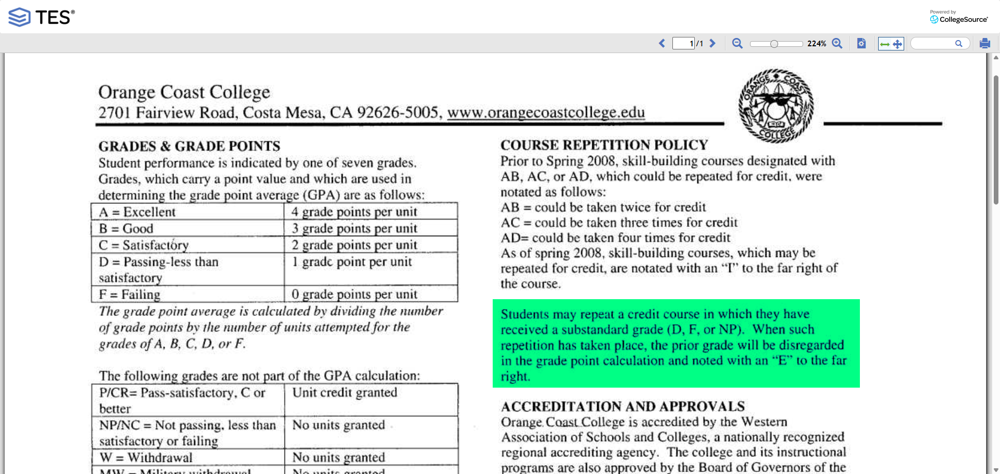

# Determining Which Courses To Ignore

[← Initial checks](transcript-evaluation-transfer-units.md) · [Transcript overview](transcript-overview.md)

## Non-Degree Applicable Courses

The degree applicability of courses from the institution should be verified to accurately evaluate transfer units.

### Checking Degree Applicability

1. From the Course Finder 2 page, click on applicable academic year of the catalog you want to review.

    

2. Click Select to view the catalog.

    

3. Navigate through the catalog to the course descriptions.

    

4. Compare between course descriptions to see what counts as degree applicable or not. This will require your judgment call based on the information provided in the catalog.

    

    !!! tip "Tip"
        Search for classic non-degree applicable courses like pre-algebra, English as a Second Language (ESL), etc. to quickly identify courses that may not count towards degree requirements and then compare with the courses you are checking from the student's transcript.

4. Line out any courses on the student's transcript that are identified as non-degree applicable based on the catalog review.

5. **DO NOT** count any units for non-degree applicable courses towards the student's transfer credit.

    !!! warning "Intermediate Algebra"
        Intermediate Algebra courses are typically considered non-degree applicable for 4-year institutions but we still count them towards transfer credit.

## In Progress Courses

The evaluation of in progress courses from the institution should be verified to accurately assess transfer units.

### Checking for In Progress Courses

1. Click on the institution's transcript key.

    

2. Review the transcript key to identify how each school indicates in progress courses.

    

3. Line out any in progress courses on the student's transcript that are not eligible for credit based on the catalog review.

4. **DO NOT** count any units for in progress courses towards the student's transfer credit until the courses are completed and grades are posted.

## Repeated Courses

The evaluation of repeated courses from the institution should be verified to accurately assess transfer units.

### Checking for Repeated Courses

1. Click on the institution's transcript key.

    

2. Review the transcript key to identify how each school indicates repeated courses.

    

3. Line out any repeated courses on the student's transcript that are not eligible for credit based on the catalog review.

4. Only count these units in the UNITS ATMPT column on the transcript.

    !!! note "Alternative Transcript Key Checking Option"
        If the transcript key information is not available on the Course Finder 2 page, you can alternatively check the institution's official website or review the corresponding catalog on TES to verify the transcript key used by the institution.

## Next Step

Compare external courses with local coursework using [Transfer Unit Scenarios & Verification](transcript-transfer-unit-scenarios.md).
