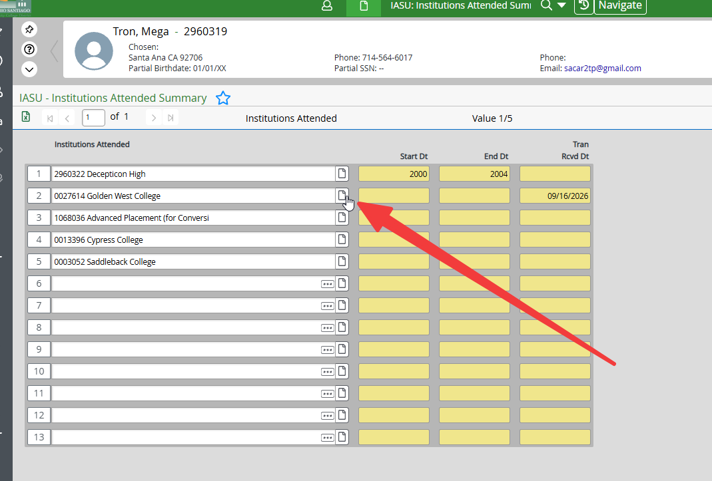
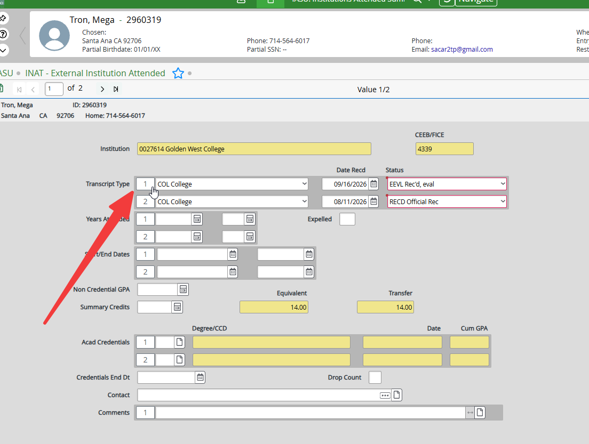
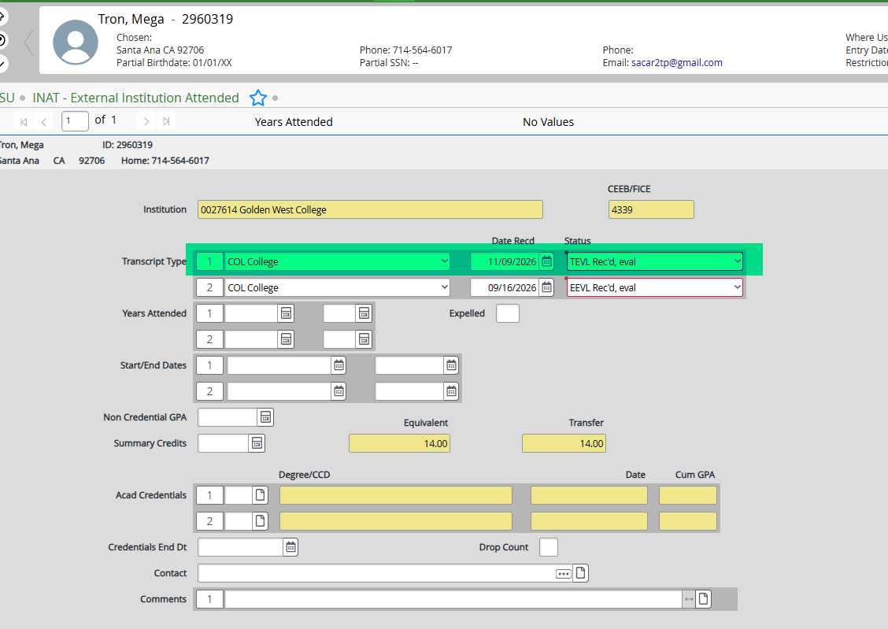
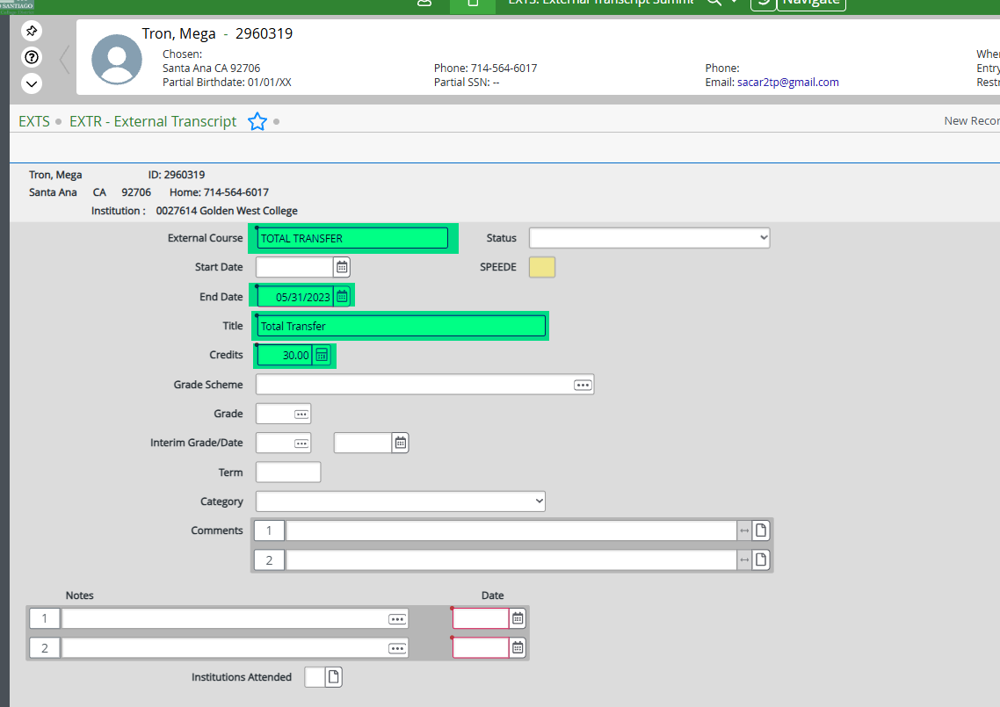
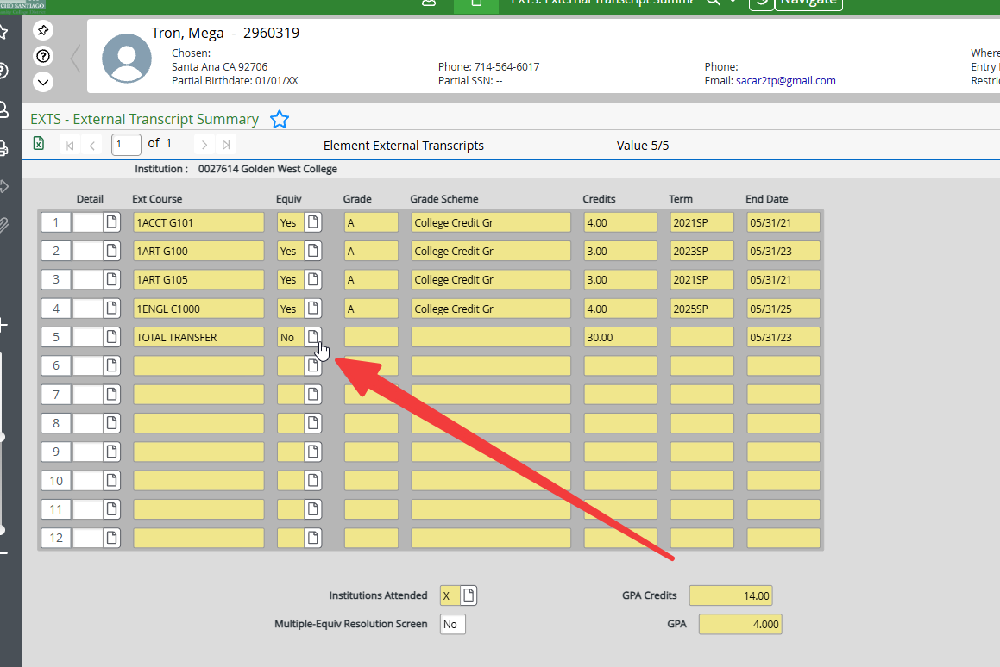
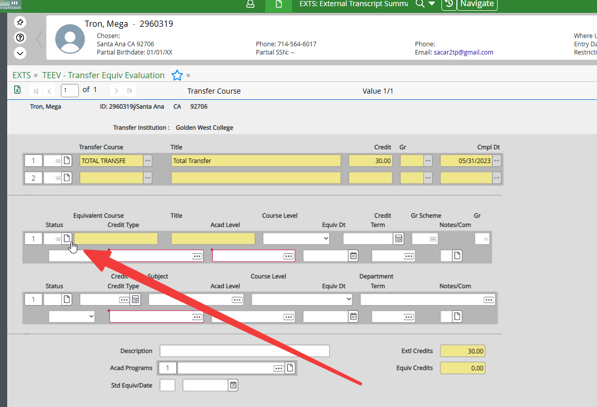
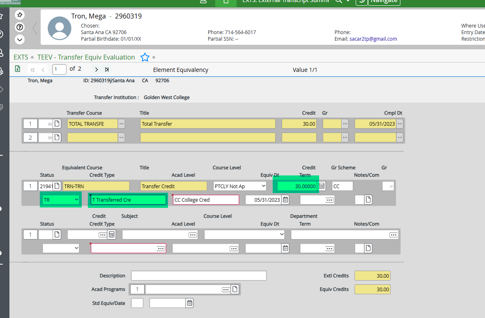
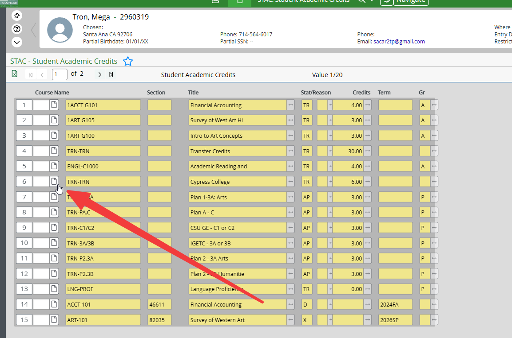
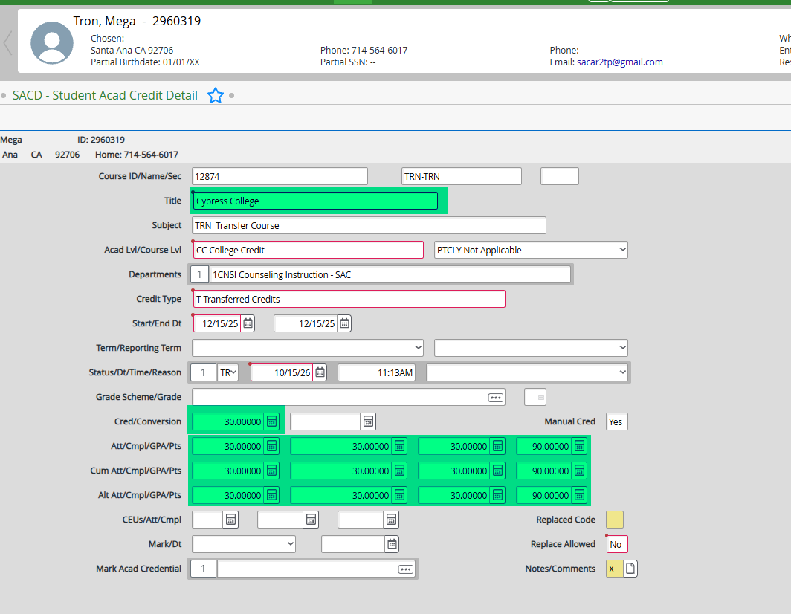

# Total Transfer Unit Processing

[← Calculating transfer units](transcript-transfer-unit-calculation.md) · [Transcript overview](transcript-overview.md)

## Total Transfer Unit Processing

### SCAN
- Scan physical transcripts to Laserfiche.
- Electronic transcripts will already be on Laserfiche from ARII.

### IASU
1. Enter **Student ID** and press Enter.
2. Detail into the desired school.

    

3. Click `1` button to insert a new line (important for accurate transcript history).

    

4. Enter fields:

    | Field | Value |
    |-------|-------|
    | Transcript Type | `COL` — College |
    | Date Recd | Today's date |
    | Status | `UEVL` (units only) / `EEVL` (C-ID evaluated) / `TEVL` (GE evaluated) / `NOAC` (not accredited) |

    

5. If school not listed: enter school name on a new line, find the school, then repeat above.
6. Click **Save All**.

---

### EXTS
1. Enter **Student ID** and press Enter.
2. Double-click on desired school.
3. Detail into a new/empty line.
4. Enter fields:

    | Field | Value |
    |-------|-------|
    | External Course | `TOTAL TRANSFER` |
    | End Date | End date of last semester (Summer: 7/31/YY, Fall: 12/31/YY, Spring/Intersession: 5/31/YY) |
    | Title | `Total Transfer` |
    | Credits | **UNITS ATMPT** units |

    

5. Click **Save** → OK → Update → Cancel.
6. Detail into **EQUIV**.

    

7. Detail into Course Information → OK.

    

7. Type **`TRN-TRN`** (not case-sensitive) → OK.
8. Enter fields:

    | Field | Value |
    |-------|-------|
    | Credit | `UNITS ATMPT units` |
    | Status | `TR` |
    | Credit Type | `T` |

    

9. Click **Save All**.

---

### STAC
1. Enter **Student ID** and press Enter.
2. Detail into the **TRN-TRN** course you created.

    

3. Select **SACD** → OK.
4. Enter fields:

    | Field | Instructions |
    |-------|--------------|
    | **Title** | Change to school name (e.g., *Total Transfer → Fullerton College*). Use the [Naming Key](https://rsccd.sharepoint.com/:x:/r/sites/Admissions2/Shared%20Documents/Upfront%20Transcript%20Evaluation/Evaluation%20Resources/Naming%20Key%20-%20Schools.xlsx). |
    | **Att/Cmpl/GPA/Pts** | Enter totals. |
    | **Cum Att/Cmpl/GPA/Pts** | Enter totals. |
    | **Alt Att/Cmpl/GPA/Pts** | Enter totals. |

    
    
5. Detail into **Notes/Comments** → **Comments** → Timestamp → Click **Save**.

6. Click **Save All**.

---

[Review transfer unit scenarios and verification](transcript-transfer-unit-scenarios.md) · [Transcript resources](transcript-evaluation-resources.md)
