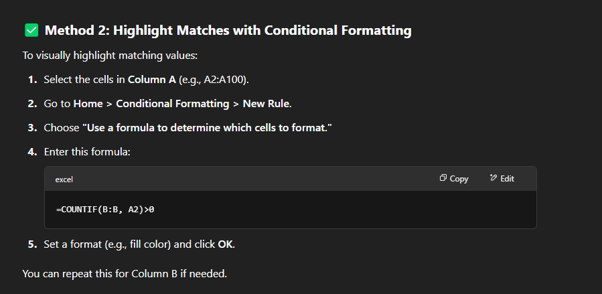

# Tips & Tricks

## STUDENT.ACAD.CRED

Reference field used in many queries to access student academic credit records.

---

## AND/OR Logic for Rules

When building rules in RLDE, use correct AND/OR logic to ensure rules fire as intended. Test rules in a non-production environment first.

---

## Concatenating Using Dates

Use date concatenation in queries to build term codes or compare date ranges.

---

## Chopping Off the End of a Value

Use string functions to truncate values for matching or display purposes.

---

## Converting Effective Terms to Numbers for Comparison

Convert term codes (e.g., `2024FA`) to numeric values for comparison in queries. Example approach: extract the year and map the term suffix (FA, SP, SU, SI) to a numeric quarter.

---

## Creating .CSV File from File Names

Use Excel or a script to extract file names from a directory and create a .csv list for batch processing.

---

## Checking for Matches Between Two Columns with True/False Column

Insert a new column to check for matches between the two columns.
```
=COUNTIF($A:$A,B2)>0
```
- A is the column to check against for matches
- B is the column where you want to highlight matches

---

## Highlighting Matches Between 2 Columns (A and B)

- Highlight the column that you want to check has matches in the other column 
- =COUNTIF(COLUMN TO CHECK AGAINST, HIGHLIGHTED COLUMN THAT YOU WANT TO HIGHLIGHT MATCHES)>0 

    `=COUNTIF(B:B, A2)>0`

    

---

## Joining Values From One Worksheet to Another Based on Criteria

Use XLOOKUP or VLOOKUP/INDEX-MATCH to pull values from a reference table.

---

## Merge Queries in Power Query

In Excel Power Query, use Merge Queries to join datasets — similar to a SQL JOIN. Select the key column for matching.

---

## XLOOKUP

More flexible than VLOOKUP:
```excel
=XLOOKUP(lookup_value, lookup_array, return_array, [if_not_found])
```

---

## Creating Refresh Table in Power BI

Set up a scheduled refresh in Power BI Service to keep dashboards current. Ensure the data source connection is properly configured.

---

## Removing Stubborn Whitespace After Numbers

Use `TRIM()` combined with `CLEAN()` in Excel, or `SUBSTITUTE()` to remove non-breaking spaces.

---

## Auto Award Excel and Mail Merge Formatting

Format the Excel sheet for mail merge compatibility — ensure column headers match merge fields exactly.

---

## How to Set Up Mail Profiles

Configure mail profiles in Outlook for routing communications from specific addresses (e.g., admissions@sac.edu).

---

## SQL Tips

- Use `LIKE` with wildcards for flexible string matching.
- Use `BETWEEN` for date range queries.
- Always test with a `SELECT` before running an `UPDATE` or `DELETE`.
- Use `TOP 10` or `LIMIT` to preview results before full runs.
