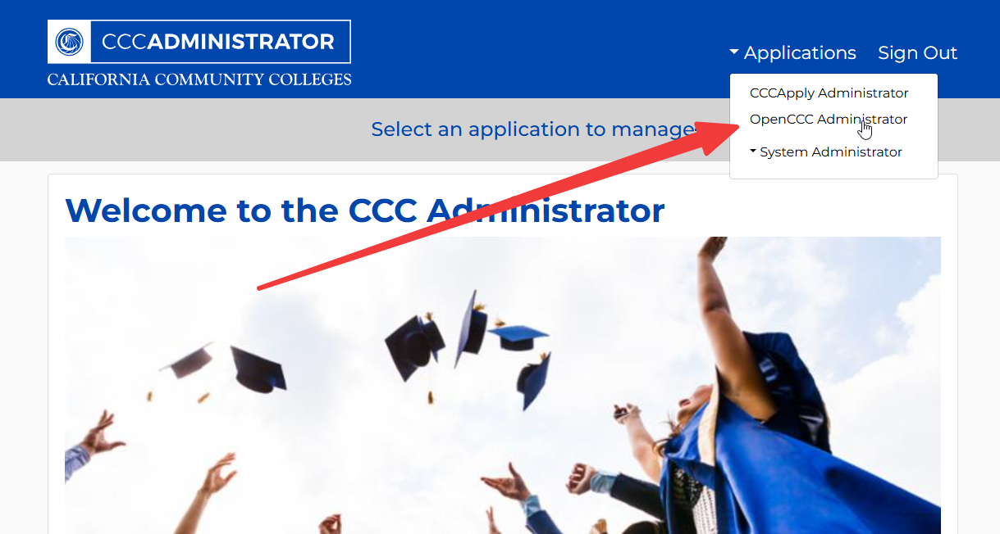
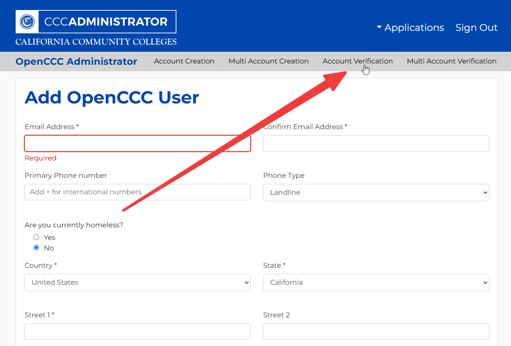
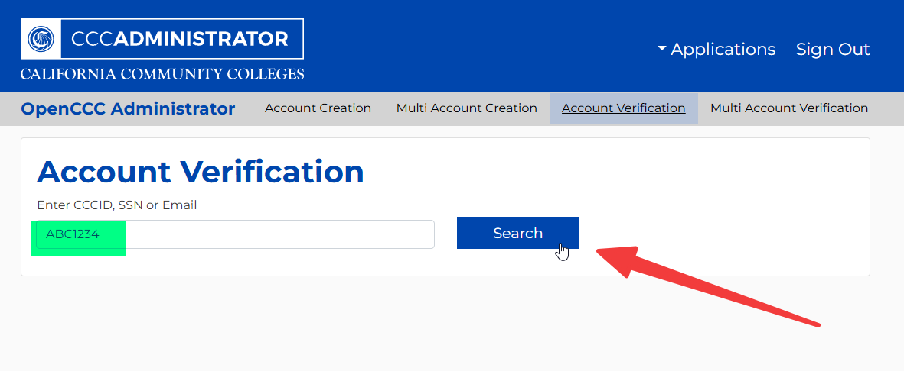
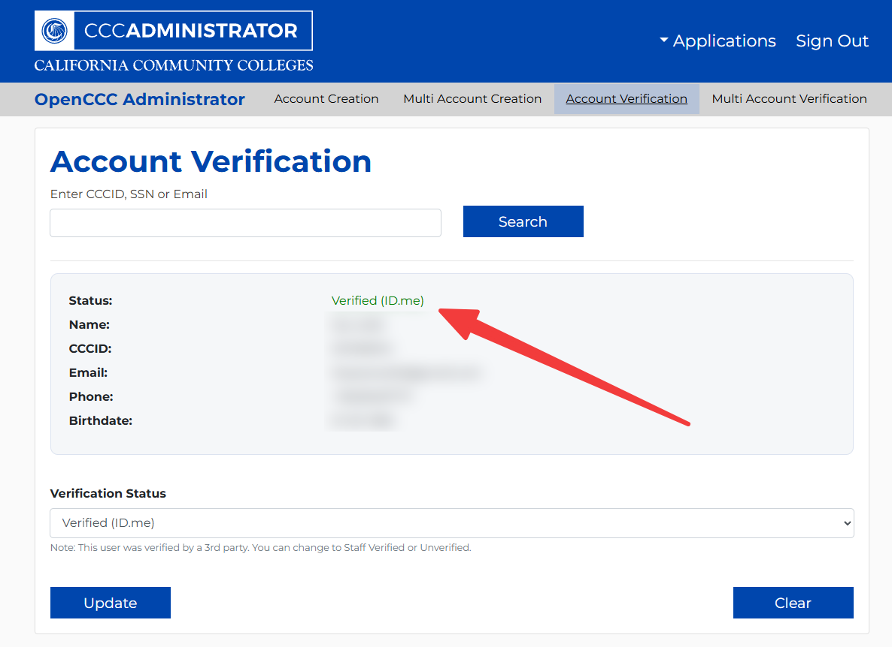
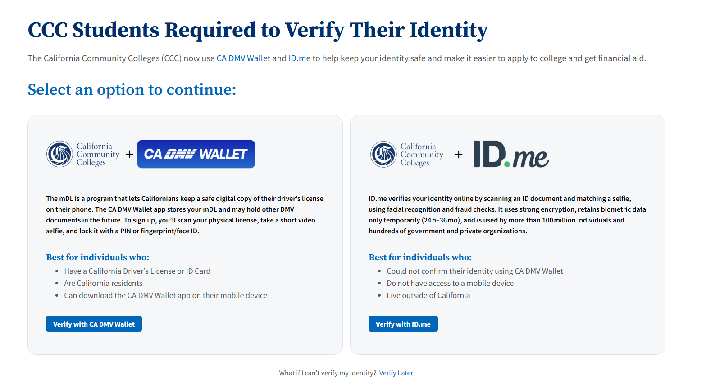

# Identity Verification

## Overview

Identity verification is a critical process to ensure that students are who they claim to be. This process helps prevent fraud and protects the integrity of the admissions and records system. The following matrix outlines the acceptable methods and documentation for verifying student identity based on age and student category.

Please use the matrix below when verifying the identity of students to ensure compliance with the established procedures. 

!!! note "CORM Flagging"
    We only need to enter CORM flags when pushing/verifying applications. For general release of information to students, CORM flags are not required.

## Fraud Identity Verification Decision Matrix: All Students

| Student Age | Student Category | Identity Verification Method / Acceptable Documentation | Documentation Collected By | A&R Action | CORM Flag |
|---|---|---|---|---|---|
| Under 18 | Dual Enrollment | Required documentation collected by the Dual Enrollment team | Dual Enrollment team | Verify documentation and enter the applicable CORM flag | `1DEV` |
| Under 18 | Early Decision | Transcript printout, high school ID, California ID/Driver's License, or Aeries screenshot | Outreach staff | Verify documentation and enter the applicable CORM flag | `1EDV` |
| Age 18 or older | Regular Student | ID.me or California DMV Wallet through CCCApply; alternatively, Dynamic Form with a California ID/Driver's License, U.S. passport | A&R Staff | Verify identity using the submitted verification method | `1IDSV` |
| Age 18 or older | Undocumented Student | ID.me, California DMV Wallet, or the Dynamic Form government-issued ID option in CCCApply | A&R Staff | Verify identity using the submitted verification method | `1IDSV` |
| Age 18 or older | F-1 Student | ID.me, California DMV Wallet, or the Dynamic Form government-issued ID option in CCCApply | A&R Staff | Verify identity using the submitted verification method | `1IDSV` |

### Fraud Identity Verification General Process

1. The student submits a CCCApply application.
2. Determine whether the student is:
    - Under 18, or
    - Age 18 or older.

3. Follow the applicable verification process in the matrix above.

> **Important:** Students under 18 are not currently prompted to complete identity verification. Students age 18 or older are required to complete identity verification.

### How To Check Student Identity Verification Status

1. Navigate to [CCCAdministrator](https://admin.ccctechcenter.org/).
2. Click on **Applications** and then **OpenCCC Administrator**.

    

3. Click on **Account Verification**.

    

4. Enter the student's CCID, SSN, or Email and click **Search**.

    

3. Check the identity verification status field to determine if the student has completed the verification process.

    

### How Students Can Complete Identity Verification Through CCCApply

1. Have the student log in to their CCCApply account.
2. If student is not verified, they should be prompted to complete the identity verification process through CCCApply.

    

3. Once the student completes the identity verification process, CCCApply will update their verification status.
4. Check the student's verification status through [CCCAdministrator](https://admin.ccctechcenter.org/).